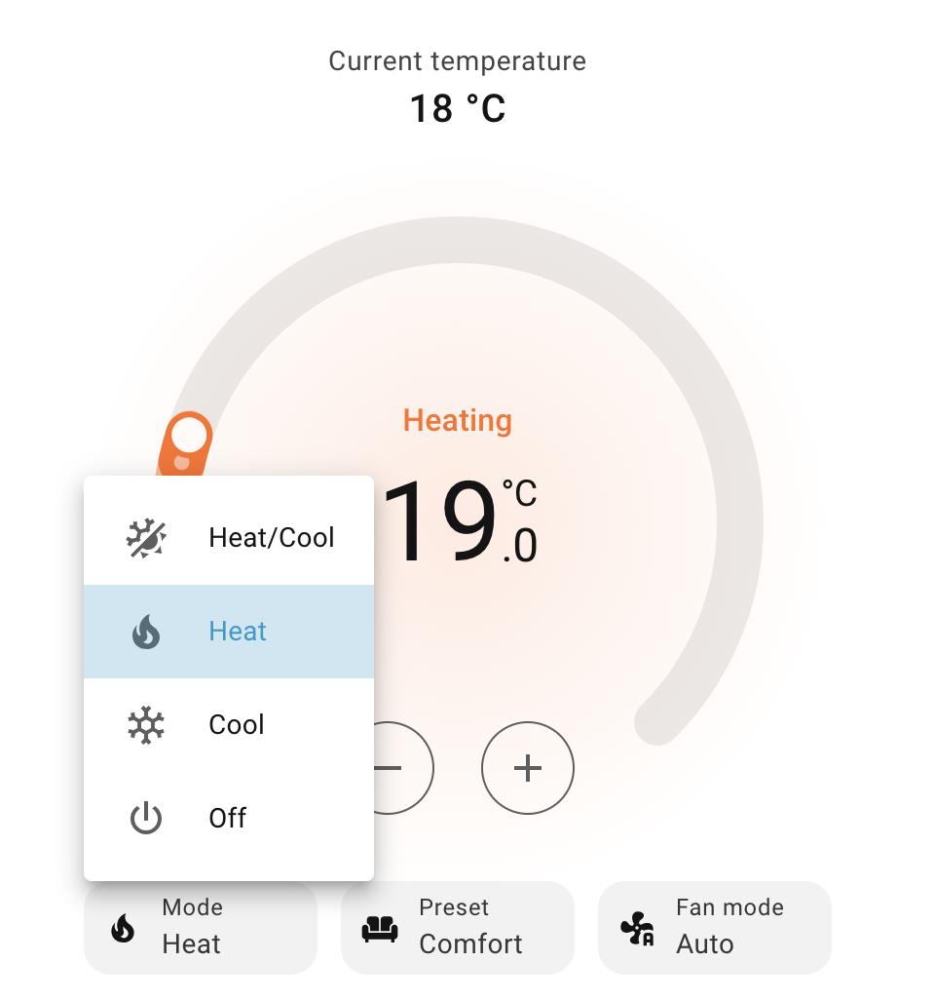

# Climate Control Guide

Learn how to control your Hitachi heat pump zones through Home Assistant climate entities.

## Overview

Each air zone (C1/C2 room thermostat) and each water circuit (C1/C2 water) in your Hitachi system appears as a **climate entity** in Home Assistant. DHW and the swimming pool are exposed as water heater entities instead (see [Water Heater Control](Water-Heater-Control.md)). Climate entities provide control over:

- **Temperature** - Set target temperature
- **HVAC Mode** - Heat, Cool, Heat/Cool (Auto), or Off
- **Preset Mode** - Comfort or Eco
- **Fan Mode** - Silent mode or fan speed (system dependent)
- **Status** - Current temperature, operation status, alarms

---

## Entity Naming

Climate entities are named after the zone/room name configured in CSNet Manager:

**Format**: `climate.{zone_name}`

**Examples**:
- `climate.living_room`
- `climate.first_floor`

The entity belongs to a device named `{Device Name}-{Zone Name}` (for example `Remote-Living Room`).

!!! note
    The examples on this page use `climate.remote_living_room` as a placeholder. Replace it with the entity ID shown in **Settings → Devices & Services → Entities**.

---

## Basic Controls

### Setting Target Temperature

**Via UI**:
1. Open the climate entity card
2. Use the **+** and **-** buttons
3. Or drag the temperature slider

**Via Service Call**:
```yaml
service: climate.set_temperature
target:
  entity_id: climate.remote_living_room
data:
  temperature: 22
```

**Via Automation**:
```yaml
automation:
  - alias: "Set Morning Temperature"
    trigger:
      - platform: time
        at: "07:00:00"
    action:
      - service: climate.set_temperature
        target:
          entity_id: climate.remote_living_room
        data:
          temperature: 21
```

**Temperature Range**:

The integration reads the limits reported by your unit. When the unit does not report them, these defaults apply:

| Zone | Heating | Cooling |
|------|---------|---------|
| Air circuits (C1/C2 air) | 11-35°C | 11-35°C |
| Water circuits (C1/C2 water) | 20-80°C | 5-22°C |

If [Maximum Temperature Override](Configuration-Guide.md#field-details) is set, it replaces the maximum for every climate entity in every mode. See [Dynamic Temperature Limits](Advanced-Features.md#dynamic-temperature-limits).

### Changing HVAC Mode

Every climate entity lists all four modes; whether your unit accepts Cool or Heat/Cool depends on its configuration.

| Mode | CSNet mode | Description |
|------|-----------|-------------|
| **Off** | run/stop = 0 | Zone stopped; the last mode is kept on the unit |
| **Heat** | 1 | Heating |
| **Cool** | 0 | Cooling (if your system supports it) |
| **Heat/Cool** | 2 | Automatic heating/cooling ("Auto" on the unit) |

**Via UI**:
1. Click on climate entity
2. Click the mode button (shows current mode)
3. Select desired mode



**Via Service Call**:
```yaml
service: climate.set_hvac_mode
target:
  entity_id: climate.remote_living_room
data:
  hvac_mode: heat
```

**Via Automation**:
```yaml
automation:
  - alias: "Winter Mode"
    trigger:
      - platform: numeric_state
        entity_id: sensor.system_controller_outdoor_temperature
        below: 15
    action:
      - service: climate.set_hvac_mode
        target:
          entity_id: climate.remote_living_room
        data:
          hvac_mode: heat
```

### Turning On/Off

**Quick On/Off**:
```yaml
# Turn on
service: climate.turn_on
target:
  entity_id: climate.remote_living_room

# Turn off
service: climate.turn_off
target:
  entity_id: climate.remote_living_room
```

**Note**: `turn_on` restores the last mode reported by the unit (Heat, Cool, or Heat/Cool), or Heat if none is known.

### Using Preset Modes

Preset modes switch the circuit's eco/comfort setting on the unit (`ecoModeC{n}`):

| Preset | Description |
|--------|-------------|
| **Comfort** | Normal operation |
| **Eco** | The unit's eco mode; how much the setpoint changes is configured on the unit, not in Home Assistant |

If the unit reports no eco/comfort state for a zone, the preset shows as Comfort.

**Via UI**:
1. Open climate entity
2. Click **Preset** button
3. Select **Comfort** or **Eco**

**Via Service Call**:
```yaml
service: climate.set_preset_mode
target:
  entity_id: climate.remote_living_room
data:
  preset_mode: eco
```

**Via Automation** (Eco mode at night):
```yaml
automation:
  - alias: "Night Eco Mode"
    trigger:
      - platform: time
        at: "23:00:00"
    action:
      - service: climate.set_preset_mode
        target:
          entity_id: climate.remote_living_room
        data:
          preset_mode: eco
          
  - alias: "Morning Comfort Mode"
    trigger:
      - platform: time
        at: "06:30:00"
    action:
      - service: climate.set_preset_mode
        target:
          entity_id: climate.remote_living_room
        data:
          preset_mode: comfort
```

---

## Advanced Controls

### Fan Mode Control

Fan mode behavior depends on your system type:

#### Non-Fan Coil Systems

**Silent Mode** - Reduces outdoor unit noise:
- **Auto** = Normal operation
- **On** = Silent mode enabled

```yaml
service: climate.set_fan_mode
target:
  entity_id: climate.remote_living_room
data:
  fan_mode: "on"  # Silent mode
```

#### Fan Coil Systems

**Fan Speed Control** - the available speeds depend on the **Fan Coil Control Model** option ([Configuration Guide](Configuration-Guide.md#field-details)):

| Model | Fan modes (API value 0, 1, 2, 3) |
|-------|----------------------------------|
| `standard` (default) | `off`, `low`, `medium`, `auto` |
| `legacy` | `low`, `medium`, `high`, `auto` |

```yaml
service: climate.set_fan_mode
target:
  entity_id: climate.remote_living_room
data:
  fan_mode: medium
```

**Checking System Type**:

Look at the climate entity attributes:
```yaml
is_fan_coil_compatible: true  # or false
fan_coil_model: standard      # or legacy
fan_modes: ["off", "low", "medium", "auto"]  # Fan coil, standard model
fan_modes: ["low", "medium", "high", "auto"] # Fan coil, legacy model
fan_modes: ["auto", "on"]                    # No fan coil (silent mode)
```

With the `standard` model, fan coil support is detected from the unit; with `legacy`, every climate entity is treated as a fan coil.

### Fixed Water Temperature Control (Water Circuits Only)

For **water circuits** (C1 Water and C2 Water), you can control the fixed water supply temperature when your system is configured in **Fixed Temperature mode** (OTC type = FIX).

#### Understanding OTC (Outdoor Temperature Compensation)

Your Hitachi system can operate in different **OTC (Outdoor Temperature Compensation)** modes:

- **Fixed Mode (FIX)**: Water temperature is set to a fixed value you control
- **Gradient/Points Mode**: Water temperature is automatically calculated based on outdoor temperature

**Important**: Fixed water temperature control is **only available when OTC type is set to FIX**. If your system uses Gradient or Points mode, the water temperature is automatically calculated and cannot be manually set.

#### Checking Your OTC Mode

Check the climate entity attributes (each entity shows the OTC type of its own circuit), or the `sensor.system_controller_otc_*` sensors:

```yaml
otc_heating_type: 3  # 3 = Fixed mode
otc_heating_type_name: "Fixed"
otc_cooling_type: 2  # 2 = Fixed mode
otc_cooling_type_name: "Fixed"
```

**OTC Type Values**:
- **Heating**: None (0), Points (1), Gradient (2), **Fixed (3)**
- **Cooling**: None (0), Points (1), **Fixed (2)**

#### Number Entities for Fixed Water Temperature

These are the integration's only **number** entities. One is created per circuit and mode whose OTC type is **Fixed** when the integration loads:

**Entity Names**:
- `number.{zone_name}_fixed_water_temperature_heating_c1` - C1 heating mode
- `number.{zone_name}_fixed_water_temperature_cooling_c1` - C1 cooling mode
- `number.{zone_name}_fixed_water_temperature_heating_c2` - C2 heating mode
- `number.{zone_name}_fixed_water_temperature_cooling_c2` - C2 cooling mode

**Examples**:
- `number.salon_fixed_water_temperature_heating_c1`
- `number.bibliotheque_fixed_water_temperature_cooling_c2`

**Note**: These entities are **circuit-level** settings (`fixTempHeatC1`, `fixTempCoolC1`, `fixTempHeatC2`, `fixTempCoolC2`) that affect both the air zone and the water zone of the same circuit. The entity is attached to the circuit's air zone device when one exists, otherwise to the water zone device, and `{zone_name}` is that zone's name.

The entity is unavailable whenever the circuit's OTC type for that mode is not Fixed.

#### Using Fixed Water Temperature Control

**Via UI**:
1. Open the number entity (e.g., `number.salon_fixed_water_temperature_heating_c1`)
2. Adjust the temperature value
3. The value is saved automatically

**Via Service Call**:
```yaml
service: number.set_value
target:
  entity_id: number.salon_fixed_water_temperature_heating_c1
data:
  value: 45  # Set fixed water temperature to 45°C
```

**Via Automation**:
```yaml
automation:
  - alias: "Set Fixed Water Temperature for Winter"
    trigger:
      - platform: time
        at: "06:00:00"
    action:
      - service: number.set_value
        target:
          entity_id: number.salon_fixed_water_temperature_heating_c1
        data:
          value: 50  # Higher temperature for cold days
          
  - alias: "Set Fixed Water Temperature for Spring"
    trigger:
      - platform: time
        at: "20:00:00"
    condition:
      - condition: numeric_state
        entity_id: sensor.system_controller_outdoor_temperature
        above: 15
    action:
      - service: number.set_value
        target:
          entity_id: number.salon_fixed_water_temperature_heating_c1
        data:
          value: 40  # Lower temperature for milder weather
```

#### Climate Entity Behavior for Water Circuits

For **water zones** (zone_id 5 = C1 Water, zone_id 6 = C2 Water):

- **When OTC type is FIX**: The climate entity's `target_temperature` shows the fixed water temperature and can be edited
- **When OTC type is NOT FIX** (Gradient/Points): The climate entity's `target_temperature` returns `None` (unavailable) since the temperature is automatically calculated

**For air zones** (zone_id 1 = C1 Air, zone_id 2 = C2 Air):
- The climate entity's `target_temperature` always shows the **room temperature** (`settingTempRoomZ1/Z2`) and is always editable
- Fixed water temperature is controlled via the **separate number entity** (when OTC is FIX)
- Room temperature and fixed water temperature are **independent settings**

#### Temperature Range

The number entities use fixed ranges, in 1°C steps:
- **Heating**: 20°C to 80°C
- **Cooling**: 5°C to 22°C

The unit may apply narrower limits of its own.

#### Why Don't I See the Number Entity?

If you don't see the fixed water temperature number entity, it's because:

1. **Your OTC type is NOT FIX** - The entity is only created for circuits/modes whose OTC type is Fixed
2. **The OTC type changed after the integration loaded** - Number entities are created only at setup

**To enable fixed temperature control**:
- Change your OTC type to FIX in the CSNet Manager app or website (or on the unit)
- Reload the integration (**Settings → Devices & Services → Hitachi CSNet Home → ⋮ → Reload**) so the number entity is created

#### Example: Seasonal Temperature Adjustment

```yaml
automation:
  - alias: "Winter Fixed Water Temperature"
    trigger:
      - platform: numeric_state
        entity_id: sensor.system_controller_outdoor_temperature
        below: 5
        for: "01:00:00"
    action:
      - service: number.set_value
        target:
          entity_id: number.salon_fixed_water_temperature_heating_c1
        data:
          value: 55  # Higher temperature for cold weather
          
  - alias: "Spring Fixed Water Temperature"
    trigger:
      - platform: numeric_state
        entity_id: sensor.system_controller_outdoor_temperature
        above: 15
        for: "01:00:00"
    action:
      - service: number.set_value
        target:
          entity_id: number.salon_fixed_water_temperature_heating_c1
        data:
          value: 40  # Lower temperature for milder weather
```

#### Troubleshooting

**Entity Not Available**:
- Check that OTC type is FIX in climate entity attributes
- Verify the number entity exists in Home Assistant
- Check integration logs for errors

**Temperature Not Changing**:
- Ensure OTC type is FIX (not Gradient/Points)
- Check that the number entity is available
- Verify the value is within the allowed range (check min/max)

**Want to Use Fixed Mode**:
- Change OTC type to FIX in CSNet Manager app/website
- Reload the integration so the number entity is created
- You can then set fixed water temperature via Home Assistant

---

## Reading Climate State

### Current Temperature

The actual measured temperature in the zone:

```yaml
{{ state_attr('climate.remote_living_room', 'current_temperature') }}
```

### Target Temperature

The desired temperature setpoint:

```yaml
{{ state_attr('climate.remote_living_room', 'temperature') }}
```

### HVAC Action

Derived by the integration from the zone state, not from the compressor:

- **heating** - Zone on, mode Heat, and target temperature above current temperature
- **cooling** - Zone on, mode Cool, and target temperature below current temperature
- **idle** - Anything else, including when the zone is off

For the real operating state, use the `operation_status_text` attribute.

```yaml
{{ state_attr('climate.remote_living_room', 'hvac_action') }}
```

**Example Automation** (based on action):
```yaml
automation:
  - alias: "Alert When Heating"
    trigger:
      - platform: state
        entity_id: climate.remote_living_room
        attribute: hvac_action
        to: "heating"
    action:
      - service: notify.mobile_app
        data:
          message: "Heating started in living room"
```

---

## Extended Attributes

Climate entities provide additional information as attributes:

### Operation Status

Detailed operation status from the heat pump:

```yaml
operation_status: 6  # Numeric code
operation_status_text: "Heating Thermostat On"  # Human-readable
```

**Status Codes**:
- `0` - Off
- `1` - Cooling Demand Off
- `2` - Cooling Thermostat Off
- `3` - Cooling Thermostat On
- `4` - Heating Demand Off
- `5` - Heating Thermostat Off
- `6` - Heating Thermostat On
- `7` - Domestic Hot Water Off
- `8` - Domestic Hot Water On
- `9` - Swimming Pool Off
- `10` - Swimming Pool On
- `11` - Alarm

### Real Mode

The actual operating mode (may differ from set mode in Auto):

```yaml
real_mode: 1  # 0=Cool, 1=Heat, 2=Auto
```

### Circuit Demand

Shows which circuits are calling for heat/cool:

```yaml
c1_demand: true   # C1 circuit requesting
c2_demand: false  # C2 circuit not requesting
```

### Boost Status

Indicates if boost mode is active:

```yaml
doingBoost: false
```

### Alarm Information

Current alarm status:

```yaml
alarm_code: 0  # 0 = No alarm, otherwise the alarm code
```

Formatted code, origin and message are available as separate sensors (see [Sensors Reference](Sensors-Reference.md#zone-sensors)).

### Silent Mode Status

Current silent mode setting (non-fan coil):

```yaml
silent_mode: 0  # 0=Off, 1=On
```

### Fan Speeds (Fan Coil Only)

Current fan speeds for each circuit:

```yaml
fan1_speed: 3  # C1 fan speed (0-3)
fan2_speed: 2  # C2 fan speed (0-3)
fan1_control_available: true
fan2_control_available: true
```

`fanXControlledOnLCD` on the unit decides availability: fan speed can be set in heating, cooling, or both, depending on that setting. With the `legacy` fan coil model the check is skipped when setting the speed.

All climate entities also expose `fan_coil_model` (`standard` or `legacy`).

### OTC Information

Outdoor Temperature Compensation settings:

```yaml
otc_heating_type: 1
otc_heating_type_name: "Points"
otc_cooling_type: 0
otc_cooling_type_name: "None"
```

**OTC Types**:
- **Heating**: None (0), Points (1), Gradient (2), Fixed (3)
- **Cooling**: None (0), Points (1), Fixed (2)

---

## Complete Attributes Example

```yaml
climate.remote_living_room:
  state: heat
  attributes:
    current_temperature: 20.5
    temperature: 22.0
    target_temp_high: null
    target_temp_low: null
    hvac_modes:
      - "off"
      - heat
      - cool
      - heat_cool
    min_temp: 11
    max_temp: 35
    preset_modes:
      - comfort
      - eco
    preset_mode: comfort
    hvac_action: heating
    fan_modes:
      - auto
      - "on"
    fan_mode: auto
    real_mode: 1
    operation_status: 6
    operation_status_text: "Heating Thermostat On"
    timer_running: false
    alarm_code: 0
    c1_demand: true
    c2_demand: false
    doingBoost: false
    silent_mode: 0
    fan_coil_model: standard
    is_fan_coil_compatible: false
    otc_heating_type: 1
    otc_heating_type_name: "Points"
```

---

## Lovelace UI Examples

### Basic Thermostat Card

```yaml
type: thermostat
entity: climate.remote_living_room
```


### Detailed Climate Card

```yaml
type: vertical-stack
cards:
  - type: thermostat
    entity: climate.remote_living_room
    
  - type: entities
    entities:
      - entity: sensor.remote_living_room_current_temperature
        name: Current Temperature
      - entity: sensor.remote_living_room_setting_temperature
        name: Target Temperature
      - entity: climate.remote_living_room
        type: attribute
        attribute: hvac_action
        name: Action
      - entity: climate.remote_living_room
        type: attribute
        attribute: operation_status_text
        name: Status
```

### Custom Button Card (with custom:button-card)

```yaml
type: custom:button-card
entity: climate.remote_living_room
name: Living Room
show_state: true
show_icon: true
tap_action:
  action: more-info
state_display: |
  [[[ return entity.attributes.current_temperature + '°C → ' + 
      entity.attributes.temperature + '°C' ]]]
styles:
  card:
    - height: 100px
  state:
    - font-size: 14px
```

### Climate Control Panel

```yaml
type: vertical-stack
cards:
  - type: markdown
    content: "## Living Room Climate"
    
  - type: horizontal-stack
    cards:
      - type: button
        name: "Comfort"
        icon: mdi:home-thermometer
        tap_action:
          action: call-service
          service: climate.set_preset_mode
          service_data:
            entity_id: climate.remote_living_room
            preset_mode: comfort
            
      - type: button
        name: "Eco"
        icon: mdi:leaf
        tap_action:
          action: call-service
          service: climate.set_preset_mode
          service_data:
            entity_id: climate.remote_living_room
            preset_mode: eco
            
      - type: button
        name: "Off"
        icon: mdi:power
        tap_action:
          action: call-service
          service: climate.turn_off
          service_data:
            entity_id: climate.remote_living_room
  
  - type: thermostat
    entity: climate.remote_living_room
```

---

## Common Automation Examples

### Temperature Schedule

```yaml
automation:
  - alias: "Living Room Temperature Schedule"
    trigger:
      - platform: time
        at: "06:00:00"
        id: morning
      - platform: time
        at: "09:00:00"
        id: day
      - platform: time
        at: "17:00:00"
        id: evening
      - platform: time
        at: "23:00:00"
        id: night
    action:
      - choose:
          - conditions:
              - condition: trigger
                id: morning
            sequence:
              - service: climate.set_temperature
                target:
                  entity_id: climate.remote_living_room
                data:
                  temperature: 21
              - service: climate.set_preset_mode
                target:
                  entity_id: climate.remote_living_room
                data:
                  preset_mode: comfort
                  
          - conditions:
              - condition: trigger
                id: day
            sequence:
              - service: climate.set_temperature
                target:
                  entity_id: climate.remote_living_room
                data:
                  temperature: 20
              - service: climate.set_preset_mode
                target:
                  entity_id: climate.remote_living_room
                data:
                  preset_mode: eco
                  
          - conditions:
              - condition: trigger
                id: evening
            sequence:
              - service: climate.set_temperature
                target:
                  entity_id: climate.remote_living_room
                data:
                  temperature: 22
              - service: climate.set_preset_mode
                target:
                  entity_id: climate.remote_living_room
                data:
                  preset_mode: comfort
                  
          - conditions:
              - condition: trigger
                id: night
            sequence:
              - service: climate.set_temperature
                target:
                  entity_id: climate.remote_living_room
                data:
                  temperature: 18
              - service: climate.set_preset_mode
                target:
                  entity_id: climate.remote_living_room
                data:
                  preset_mode: eco
```

### Away Mode

```yaml
automation:
  - alias: "Away Mode - Turn Off Heating"
    trigger:
      - platform: state
        entity_id: person.home_owner
        to: "not_home"
        for: "01:00:00"
    action:
      - service: climate.turn_off
        target:
          entity_id: all
          
  - alias: "Return Home - Resume Heating"
    trigger:
      - platform: state
        entity_id: person.home_owner
        to: "home"
    action:
      - service: climate.turn_on
        target:
          entity_id: all
      - service: climate.set_temperature
        target:
          entity_id: climate.remote_living_room
        data:
          temperature: 21
```

### Weather-Based Control

```yaml
automation:
  - alias: "Switch to Cooling on Hot Days"
    trigger:
      - platform: numeric_state
        entity_id: weather.home
        attribute: temperature
        above: 25
    condition:
      - condition: state
        entity_id: climate.remote_living_room
        state: heat
    action:
      - service: climate.set_hvac_mode
        target:
          entity_id: climate.remote_living_room
        data:
          hvac_mode: cool
      - service: climate.set_temperature
        target:
          entity_id: climate.remote_living_room
        data:
          temperature: 24
```

### Energy Saving

```yaml
automation:
  - alias: "Eco Mode During Peak Hours"
    trigger:
      - platform: time
        at: "17:00:00"
    condition:
      - condition: time
        weekday:
          - mon
          - tue
          - wed
          - thu
          - fri
    action:
      - service: climate.set_preset_mode
        target:
          entity_id: all
        data:
          preset_mode: eco
          
  - alias: "Comfort Mode After Peak Hours"
    trigger:
      - platform: time
        at: "21:00:00"
    action:
      - service: climate.set_preset_mode
        target:
          entity_id: all
        data:
          preset_mode: comfort
```

---

## Troubleshooting

### Temperature Not Changing

**Symptoms**: Set temperature but nothing happens

**Possible Causes**:
1. **System is off** - Check HVAC mode
2. **Temperature already reached** - Check current vs target
3. **Eco mode active** - May use different setpoint
4. **Manual override** - Someone changed it at the physical thermostat

**Solutions**:
- Ensure HVAC mode is Heat or Cool (not Off)
- Check operation_status attribute
- Try toggling between Comfort and Eco
- Check CSNet Manager app for manual overrides

### Controls Not Responding

**Symptoms**: Commands sent but no effect

**Possible Causes**:
1. **Connection lost** - Check connectivity sensor
2. **CSNet Manager offline** - Service issue
3. **Device offline** - Check WiFi signal

**Solutions**:
- Check `sensor.{device}_connectivity` status
- Verify internet connection
- Check `sensor.{device}_wifi_signal` strength
- Restart integration if needed

### Wrong Temperature Reading

**Symptoms**: Current temperature seems incorrect

**Possible Causes**:
1. **Sensor location** - Thermostat placement
2. **Sync delay** - Updates every scan_interval
3. **Unit configuration** - Check CSNet Manager

**Solutions**:
- Wait for next update cycle (default 60 seconds)
- Compare with CSNet Manager app
- Check physical thermostat location
- Calibrate sensor if needed (via CSNet Manager)

---

## Tips & Best Practices

### Do

- **Use Eco mode** when sleeping or away for energy savings
- **Set realistic temperatures** (20-22°C for comfort in winter)
- **Use schedules** to automate daily routines
- **Monitor alarm_code** attribute for system issues
- **Check operation_status_text** to understand system state
- **Use silent mode at night** to reduce noise

### Don't

- **Don't change temperature too frequently** (< every 5 minutes)
- **Don't set extreme temperatures** (system won't heat/cool faster)
- **Don't turn on/off repeatedly** (causes wear)
- **Don't ignore alarms** (check alarm messages promptly)
- **Don't set scan_interval below 60 seconds** (see [Configuration Guide](Configuration-Guide.md#scan-interval))

### Pro Tips

1. **Use presets instead of temperature changes** for energy savings
2. **Monitor hvac_action** to see when actually heating/cooling
3. **Check c1_demand/c2_demand** in multi-zone to see which zones need heat
4. **Use operation_status_text** for detailed system state
5. **Enable debug logging** when troubleshooting
6. **Group zones** in the same area for coordinated control

---

## Next Steps

Learn more about related features:
- **[Water Heater Control](Water-Heater-Control.md)** - Control your DHW system
- **[Sensors Reference](Sensors-Reference.md)** - All available sensors
- **[Advanced Features](Advanced-Features.md)** - Silent mode, fan control, OTC
- **[Multi-Zone Configuration](Multi-Zone-Configuration.md)** - Managing multiple circuits
- **[Troubleshooting](Troubleshooting.md)** - Common issues and solutions

---

**[← Back to Configuration](Configuration-Guide.md)** | **[Next: Water Heater →](Water-Heater-Control.md)**

