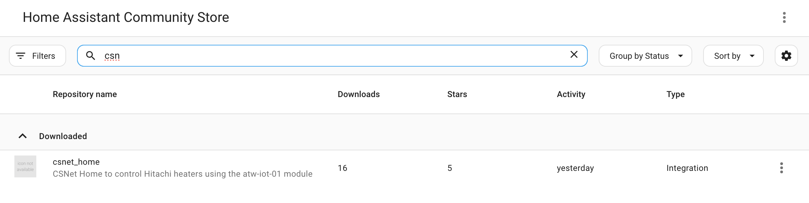
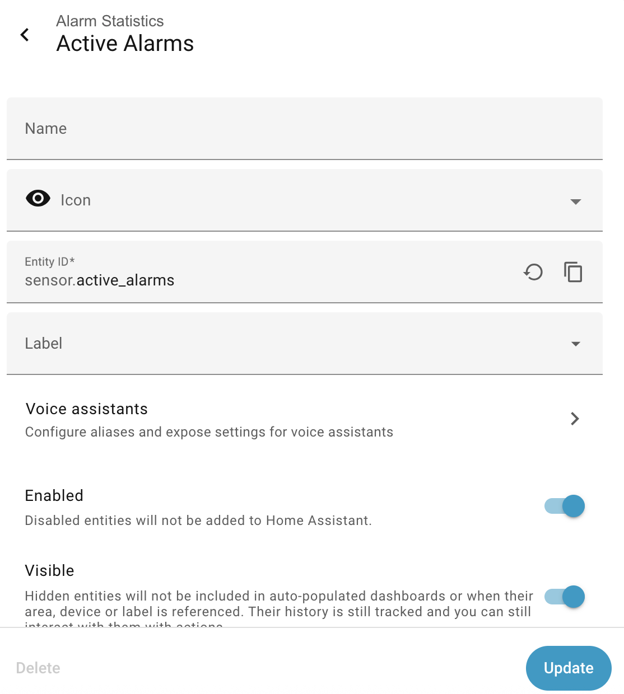
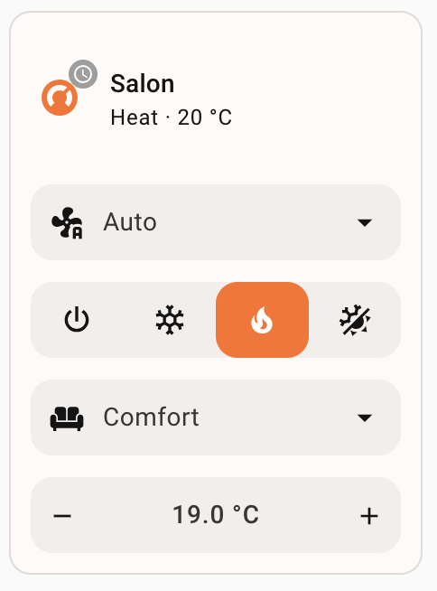

# Configuration Guide

This guide will help you configure the Hitachi CSNet Home integration after installation.

## Prerequisites

Before configuring, ensure:

✅ Integration is installed (see [Installation Guide](Installation-Guide.md))  
✅ Home Assistant has been restarted  
✅ You have your CSNet Manager credentials ready  
✅ Your Hitachi system is connected to CSNet Manager and working

---

## Initial Configuration

### Step 1: Add the Integration

1. Open **Home Assistant**
2. Navigate to **Settings** → **Devices & Services**
3. Click the **+ Add Integration** button (bottom right)
4. Search for **"Hitachi"** or **"CSNet"**
5. Click on **Hitachi CSNet Home**



### Step 2: Enter Your Credentials

You'll see a configuration dialog with the following fields:

| Field | Description | Default |
|-------|-------------|---------|
| **Username** | Your CSNet Manager username | – |
| **Password** | Your CSNet Manager password | – |
| **Scan Interval** | Update frequency in seconds | `60` |
| **Language** | Language for device names and alarm messages | `en` |
| **Maximum Temperature Override** | Optional maximum temperature (8-80°C) | empty (device limits) |
| **Fan Coil Control Model** | `standard` or `legacy` fan speed mapping | `standard` |
| **Enable Alarm Notifications** | Create persistent notifications for new alarms | enabled |
| **Filtered Alarm Codes** | Comma-separated alarm codes that never create a notification | `-1` |


#### Field Details

**Username & Password**
- Use the **same credentials** you use for:
  - CSNet Manager mobile app
  - CSNet Manager website (www.csnetmanager.com)
- Credentials are stored in the Home Assistant config entry (in the `.storage` folder of your configuration directory)

**Scan Interval** (Optional)
{ #scan-interval }

- How often the integration polls CSNet Manager (in seconds)
- **Default and minimum**: 60 seconds. The form refuses lower values, and an entry saved earlier with a lower value is polled every 60 seconds
- Each poll makes 3 requests to csnetmanager.com (elements, installation devices, installation alarms)

!!! note "Why there is a 60-second floor"
    CSNet Manager is a service Hitachi provides for its own app, without any official API, and every Home Assistant instance polling it adds load. Faster polling makes no difference to a heating system that changes over minutes. When sign-in fails, the integration also waits longer and longer between attempts (see [Known limitations](How-It-Works.md#known-limitations)).

**Language** (Optional)
- Language of the CSNet Manager translations used for alarm messages and alarm origins
- **Options**: `en` (English), `fr` (French), `es` (Spanish)
- **Default**: `en`
- The reconfigure form currently offers only `en` and `fr`

**Maximum Temperature Override** (Optional, Advanced)
- Replaces the maximum temperature of **every climate entity** (all zones, all modes, including cooling) and of the **DHW water heater**
- Does not apply to the swimming pool (fixed 24-33°C) or to the fixed water temperature number entities
- **Range**: 8-80°C
- **Default behavior** (when empty): limits reported by the unit, with these fallbacks:
  - Air circuits (zones 1/2): 35°C
  - Water circuits (zones 5/6): 80°C heating, 22°C cooling
  - Water heater (DHW): `dhwMax` reported by the unit, else 80°C
- Setting this above the manufacturer's specification does not make the unit accept higher setpoints
- Leave empty unless you have a specific reason to override

**Fan Coil Control Model** (Optional)
- `standard` (default): fan coil support is detected from the unit (`systemConfigBits`), fan modes are `off`, `low`, `medium`, `auto`
- `legacy`: forces fan coil mode on every climate entity, with fan modes `low`, `medium`, `high`, `auto`, and skips the per-circuit fan availability check
- Choose `legacy` only if fan speeds are mislabelled or missing with `standard`. See [Fan Speed Control](Advanced-Features.md#fan-speed-control-fan-coil-systems)

**Enable Alarm Notifications** (Optional)
- When enabled (default), the integration creates a Home Assistant persistent notification when a zone reports a new alarm code, and for each active installation alarm
- When disabled, no notifications are created; alarm sensors keep working

**Filtered Alarm Codes** (Optional)
- Comma-separated list of integer alarm codes that never create a notification, for example `-1,42`
- **Default**: `-1` (communication errors, which tend to appear and clear on their own)
- Leave empty to be notified of every alarm
- If any entry is not an integer, the whole list is ignored (a warning is logged) and every alarm is notified
- Filtering only affects notifications: the alarm still appears in the alarm sensors

See [Alarm Notifications](Advanced-Features.md#built-in-alarm-notifications) for details.

### Step 3: Submit Configuration

1. Enter your credentials
2. Adjust scan interval if needed (60 seconds is recommended)
3. Select your preferred language
4. Click **Submit**

### Step 4: Wait for Authentication

The integration will:
1. Connect to CSNet Manager
2. Authenticate your credentials
3. Retrieve your system configuration
4. Create entities for your devices

This usually takes 5-10 seconds.

### Step 5: Verify Success

If successful, you'll see:
- **Configuration created** message
- New devices in **Settings** → **Devices & Services**
- Entities created for your zones and sensors


---

## What Gets Created

After configuration, the integration automatically creates entities based on your system.

!!! note "Entity IDs are patterns"
    Home Assistant derives entity IDs from entity names, which come from the device and room names in CSNet Manager. `{device}` below is the CSNet device name (often `Remote`), `{zone}` the zone/room name. Examples elsewhere in this documentation, such as `climate.remote_living_room` or `water_heater.remote_dhw`, are placeholders for your own IDs.

### Devices

One device is created for **each zone** reported by CSNet Manager (air zones, water circuits, DHW, swimming pool):

**Device Name Format**: `{Device Name}-{Zone Name}`

Example: `Remote-Living Room`

Additional devices group installation-wide entities: **System-Controller**, **Compressor Outdoor Unit**, **Installation Alarms** and **Alarm Statistics**.

### Entities Per Zone

| Zone type (CSNet zone id) | Main entity | Entity ID pattern |
|---------------------------|-------------|-------------------|
| C1/C2 air circuit (1, 2) | Climate | `climate.{zone}` |
| C1/C2 water circuit (5, 6) | Climate | `climate.{zone}` |
| DHW (3) | Water heater | `water_heater.{zone}` |
| Swimming pool (4) | Water heater | `water_heater.{zone}` |

Every zone, whatever its type, also gets these sensors:

- **Current / Setting Temperature**: `sensor.{device}_{zone}_current_temperature`, `sensor.{device}_{zone}_setting_temperature`
- **Status**: `sensor.{device}_{zone}_mode`, `_on_off`, `_doingboost`, `_unit_type`
- **Alarms**: `sensor.{device}_{zone}_alarm_code`, `_alarm_active`, `_alarm_message`, `_alarm_code_formatted`, `_alarm_origin`
- **Device sensors**: `sensor.{device}_wifi_signal`, `sensor.{device}_connectivity`, `sensor.{device}_last_communication` (one set per zone, so duplicates get `_2`, `_3` suffixes)

### Number Entities (If applicable)

When a circuit's OTC type is **Fixed**, a number entity is created to set its fixed water temperature, for example `number.{zone}_fixed_water_temperature_heating_c1`. See [Fixed Water Temperature Control](Climate-Control.md#fixed-water-temperature-control-water-circuits-only).

### System-Wide Sensors

Additional sensors for overall system monitoring:

#### Water System Sensors
- `sensor.system_controller_pump_speed`
- `sensor.system_controller_water_flow`
- `sensor.system_controller_in_water_temperature`
- `sensor.system_controller_out_water_temperature`
- `sensor.system_controller_external_tank_temperature`
- `sensor.system_controller_heat_exchanger_water_outlet_temperature`
- `sensor.system_controller_set_water_temperature`
- `sensor.system_controller_water_pressure`
- `sensor.system_controller_gas_temperature`
- `sensor.system_controller_liquid_temperature`

#### Environmental Sensors
- `sensor.system_controller_outdoor_temperature`
- `sensor.system_controller_outdoor_average_temperature`
- `sensor.system_controller_weather_temperature`

#### System Status Sensors
- `sensor.system_controller_defrost`
- `sensor.system_controller_mix_valve_position`
- `sensor.system_controller_central_control_enabled`
- `sensor.system_controller_unit_model`
- `sensor.system_controller_lcd_software_version`
- `sensor.system_controller_central_config`

#### Configuration Sensors
- `sensor.system_controller_fan_coil_compatible`
- `sensor.system_controller_c1_thermostat_present`
- `sensor.system_controller_c2_thermostat_present`
- `sensor.system_controller_cascade_slave_mode`

#### OTC (Outdoor Temperature Compensation) Sensors
- `sensor.system_controller_otc_heating_type_c1`
- `sensor.system_controller_otc_cooling_type_c1`
- `sensor.system_controller_otc_heating_type_c2`
- `sensor.system_controller_otc_cooling_type_c2`

#### Energy and Performance Sensors (estimated)
- `sensor.system_controller_instant_consumption`
- `sensor.system_controller_output_power`
- `sensor.system_controller_instant_cop`
- `sensor.system_controller_daily_consumption`
- `sensor.system_controller_daily_output_energy`
- `sensor.system_controller_daily_hvac_cop`
- `sensor.system_controller_dhw_daily_cop`

#### Compressor / Outdoor Unit Sensors
- 28 sensors such as `sensor.compressor_outdoor_unit_compressor_frequency`; see [Compressor Sensors](../COMPRESSOR_SENSORS.md)

#### Alarm Sensors
- `sensor.alarm_history` - Recent alarm history
- `sensor.total_alarms` - Number of zones in alarm
- `sensor.active_alarms` - Zones in alarm, listed in attributes
- `sensor.alarms_by_origin` - Alarms grouped by origin

See [Sensors Reference](Sensors-Reference.md) for details on every sensor.

---

## Configuration Examples

### Example 1: Single Zone with DHW

**System**: Yutaki S with 1 zone and water heater

**Created Entities**:
- `climate.zone_1` - Main zone climate control
- `water_heater.dhw` - Water heater (named after the DHW zone in CSNet Manager)
- `sensor.remote_zone_1_current_temperature`
- `sensor.remote_zone_1_setting_temperature`
- Plus all system-wide sensors

### Example 2: Two Zones (C1 and C2)

**System**: Yutaki S with floor heating on 2 floors

**Created Entities**:
- `climate.first_floor` - C1 circuit
- `climate.second_floor` - C2 circuit
- Sensors for each zone
- System-wide sensors

### Example 3: Multi-Zone with DHW

**System**: Yutaki SC with 2 thermostats + DHW

**Created Entities**:
- `climate.living_room` - C1 thermostat
- `climate.bedrooms` - C2 thermostat
- `water_heater.dhw` - Water heater
- All zone sensors
- All system sensors

### Example 4: Fan Coil System

**System**: Fan coil compatible with 2 zones

**Created Entities**:
- `climate.zone_1` - With fan speed control
- `climate.zone_2` - With fan speed control
- Additional fan speed attributes (`fan1_speed`, `fan2_speed`, `fan1_control_available`, `fan2_control_available`)

---

## Customizing Entity Names

After creation, you can customize entity names:

### Renaming Entities

1. Go to **Settings** → **Devices & Services** → **Entities**
2. Search for your CSNet entities
3. Click on an entity
4. Click the **Settings** icon (gear)
5. Change **Name** and/or **Entity ID**
6. Click **Update**



### Organizing with Areas

Assign entities to Home Assistant areas:

1. Go to **Settings** → **Devices & Services**
2. Click on your CSNet device
3. Click **Area** dropdown
4. Select or create an area (e.g., "Living Room", "First Floor")
5. Entities will be grouped by area in the UI

### Creating Groups

Group related entities:

```yaml
# configuration.yaml
group:
  heating_first_floor:
    name: First Floor Heating
    entities:
      - climate.remote_first_floor
      - sensor.remote_first_floor_current_temperature
      - sensor.remote_first_floor_setting_temperature
```

---

## Advanced Configuration Options

### Adjusting Scan Interval, Language and Other Options

All settings, including credentials, are changed through the **reconfigure** flow (there is no separate options dialog). See [Reconfiguring](#reconfiguring).

**Scan interval recommendations**:
- **Normal use**: 60-120 seconds
- **Low priority**: 180-300 seconds
- 60 seconds is the minimum (see [Scan Interval](#scan-interval))

### Enabling Debug Logging

For troubleshooting, enable detailed logging:

```yaml
# configuration.yaml
logger:
  default: warning
  logs:
    custom_components.csnet_home: debug
```

After adding, restart Home Assistant and check logs:
- **Settings** → **System** → **Logs**
- Filter for `csnet_home`

---

## Troubleshooting Configuration

### Authentication Failed

**Problem**: "Invalid credentials" or "Authentication failed"

**Solutions**:
1. **Verify credentials**: Test login at [CSNet Manager website](https://www.csnetmanager.com)
2. **Check for typos**: Carefully re-enter username and password
3. **Reset password**: Use CSNet Manager to reset if needed
4. **Check account status**: Ensure account is active

### No Entities Created

**Problem**: Configuration succeeds but no entities appear

**Solutions**:
1. **Wait a few minutes**: Initial sync can take time
2. **Check device**: Go to Settings → Devices & Services → Devices
3. **Restart HA**: Sometimes requires a restart to appear
4. **Check logs**: Look for errors in Settings → System → Logs
5. **Verify CSNet setup**: Ensure devices show in CSNet Manager app

### Wrong Number of Entities

**Problem**: Expected more/fewer zones or sensors

**Solutions**:
1. **Check CSNet Manager**: Verify how many zones are configured there
2. **Review system type**: Some sensors only appear for specific configurations
3. **Check DHW**: Water heater entity only created if DHW is configured
4. **Reload integration**: Try removing and re-adding

### Connection Timeout

**Problem**: Configuration times out

**Solutions**:
1. **Check internet**: Verify Home Assistant can reach internet
2. **Check firewall**: Ensure CSNet Manager domain is accessible
3. **Retry**: Each request times out after 10 seconds; CSNet Manager is sometimes slow

### Duplicate Entities

**Problem**: Entities created multiple times

**Solutions**:
1. **Remove old configuration**: Delete the integration completely
2. **Clean up entities**: Manually remove duplicate entities
3. **Restart HA**: Restart before re-adding
4. **Re-add integration**: Configure from scratch

---

## Reconfiguring

To change configuration:

### Option 1: Reconfigure (Keeps Data)

1. Go to **Settings** → **Devices & Services**
2. Find **Hitachi CSNet Home**
3. Click **⋮** (three dots) → **Reconfigure**
4. Update settings (the form is pre-filled with the current values)
5. Click **Submit**

The credentials are validated against CSNet Manager before saving, and the integration reloads automatically — no restart needed. The reconfigure form contains the same fields as the initial setup.

Only one CSNet Home entry can be configured per Home Assistant instance.

### Option 2: Remove and Re-add (Fresh Start)

1. Go to **Settings** → **Devices & Services**
2. Find **Hitachi CSNet Home**
3. Click **⋮** (three dots)
4. Select **Delete**
5. Confirm deletion
6. Wait 10 seconds
7. Add integration again (see Step 1)

**Note**: Removing the integration will:
- ❌ Delete all entities
- ❌ Remove from automations and dashboards
- ❌ Clear historical data
- ✅ Allow fresh configuration

---

## Verifying Configuration

After configuration, verify everything is working:

### Check Climate Entities

1. Go to **Settings** → **Devices & Services** → **Entities**
2. Filter by `climate.`
3. Verify you see your expected zones
4. Click on each to verify current temperature is reading

### Check Water Heater (If applicable)

1. Filter entities by `water_heater.`
2. Verify DHW entity exists
3. Check current temperature reading

### Check Sensors

1. Filter entities by `sensor.`
2. Look for your zone sensors
3. Verify system sensors are reporting
4. Check for any "Unknown" or "Unavailable" states

### Test Controls

1. Open a climate entity
2. Try changing target temperature
3. Verify change reflects in CSNet Manager app
4. Try changing mode (Heat/Cool)
5. Test preset modes (Eco/Comfort)



---

## Next Steps

✅ Configuration complete!

Now explore:
- **[Climate Control Guide](Climate-Control.md)** - Learn to control your zones
- **[Water Heater Control](Water-Heater-Control.md)** - Manage your DHW
- **[Sensors Reference](Sensors-Reference.md)** - Understand all sensors
- **[Advanced Features](Advanced-Features.md)** - Silent mode, fan control, OTC
- **[Multi-Zone Configuration](Multi-Zone-Configuration.md)** - Managing multiple circuits

---

## Getting Help

If you need assistance:
- Check [Troubleshooting](Troubleshooting.md) for common issues
- Review [FAQ](FAQ.md) for frequent questions
- Ask in [GitHub Discussions](https://github.com/mmornati/home-assistant-csnet-home/discussions)
- Report bugs in [GitHub Issues](https://github.com/mmornati/home-assistant-csnet-home/issues)

---

**[← Back to Installation](Installation-Guide.md)** | **[Next: Climate Control →](Climate-Control.md)**

