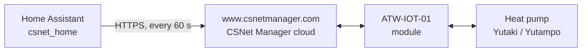

# How it works & disclaimer

!!! unofficial "Unofficial integration"
    This is an independent community project. It is **not affiliated with, endorsed by or supported by Hitachi**. Hitachi, Yutaki, Yutampo and CSNet Manager are trademarks of their respective owners and are used here only to describe compatibility. You use the integration at your own risk.

## Why it is unofficial

Hitachi replaced the older Hi-Kumo system with the **ATW-IOT-01** module, and the methods people used to read and control their units from Home Assistant stopped working. Hitachi publishes no public API for the module and provides no Home Assistant integration.

The author contacted Hitachi several times to ask for an official API, documentation, or a way to build a supported Home Assistant integration. None of those requests got a reply.

So the integration was built by observing how the [CSNet Manager](https://www.csnetmanager.com) web application talks to its own backend, and doing the same thing. In practice it behaves like a browser tab that you left open on CSNet Manager.

!!! warning "It can break without notice"
    Hitachi can change the CSNet Manager website at any time, and nothing obliges it to keep the internal endpoints stable. When that happens, the integration may stop updating or stop accepting commands until a new release adapts to the change. Check [GitHub issues](https://github.com/mmornati/home-assistant-csnet-home/issues) first if everything stops at once.

## The data path

The integration never talks to your heat pump directly and needs nothing on your local network. Everything goes through the same cloud service the official app uses, so if CSNet Manager is down or your module is offline, Home Assistant keeps showing the last values it received. Check the connectivity and last communication sensors to tell a quiet house from a broken link.

## What it does on the network

| | |
|---|---|
| **Host** | `https://www.csnetmanager.com` only. There is no telemetry, analytics or third-party service in the code. |
| **Polling interval** | 60 seconds by default, set during setup or reconfiguration. |
| **Requests per poll** | 3 HTTPS requests: `GET /data/elements`, `GET /data/installationdevices`, `GET /data/installationalarms`. |
| **On start-up** | Sign-in (`GET` then `POST /login`) and three alarm translation files (`/translations/*.json`). |
| **When you change something** | One `POST /data/indoor/heat_setting` per change (temperature, mode, preset, hot water, pool, silent mode, fan speed, fixed water temperature). Clearing an alarm calls `POST /data/deletemyspecificalarm`. |
| **Timeout** | 10 seconds per request. |
| **Session** | Signs in like the web app: fetches a CSRF token from the login page, posts the login form, then reuses the session cookie. If a read fails, it signs in again on the next read. |

### Please be gentle with the polling interval

The integration has no automatic backoff. A lower interval multiplies the load on a service that Hitachi runs for its own app and has never opened to third parties. **Keep the interval at 60 seconds or more.** Faster polling makes no difference to a heating system that changes over minutes, and an unusual traffic pattern is the easiest way to get unofficial clients noticed and blocked.

## Your credentials and data

- Your CSNet Manager **username and password are stored in the Home Assistant config entry** (in `.storage/core.config_entries`, like most cloud integrations) and are sent only to `www.csnetmanager.com`.
- Debug logging redacts the password, username, CSRF token, installation IDs and coordinates from the request payloads it prints. Debug logs can still contain raw API responses, so **read a log before you share it publicly**.
- The data the integration reads (zone names, temperatures, firmware, Wi-Fi signal, alarms, and the installation's location as stored by CSNet Manager) stays in your Home Assistant instance.
- Only one CSNet Manager account can be configured per Home Assistant instance.

## Known limitations

These come from how the integration works today. They are tracked on GitHub and may change in later releases.

- **Failed sign-in is not reported as a re-authentication prompt.** If you change your CSNet Manager password, entities stop updating; use *Reconfigure* on the integration to enter the new one.
- **No backoff on errors.** When CSNet Manager is unreachable, the integration simply tries again on the next poll.
- **Commands are confirmed by the next poll.** A change is sent immediately and Home Assistant updates the entity optimistically; the following poll shows what the unit actually accepted.
- **Cloud only.** There is no local control path. CSNet Manager must be reachable for anything to work.

## Responsible use

- Use your own account and your own installation only.
- Do not lower the polling interval to scrape data.
- If Hitachi ever publishes an official API or integration, this project will gladly move to it.

## Contributing

The best way to make the integration more robust is to share what you see. If a value is wrong or missing for your unit, open an issue with your model and a redacted `/data/elements` response (see [Troubleshooting](Troubleshooting.md)), or add your setup to the [compatibility matrix](../SUPPORTED_DEVICES.md).
